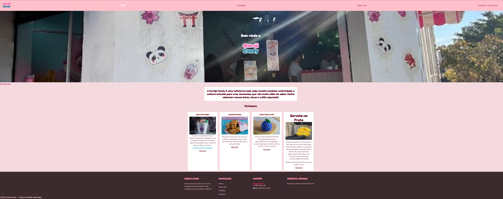
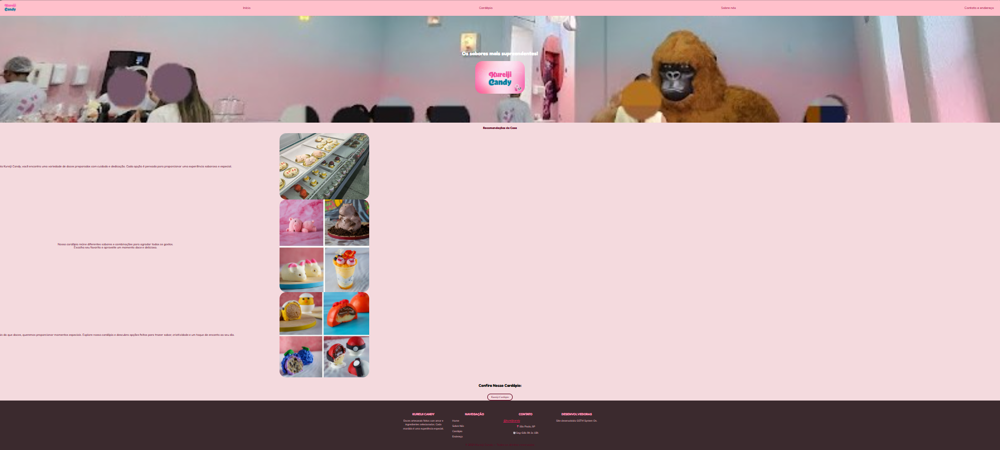
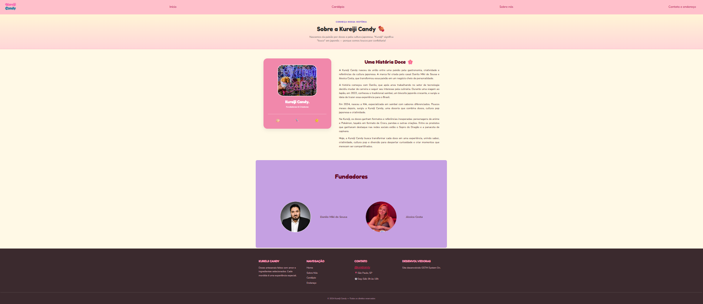
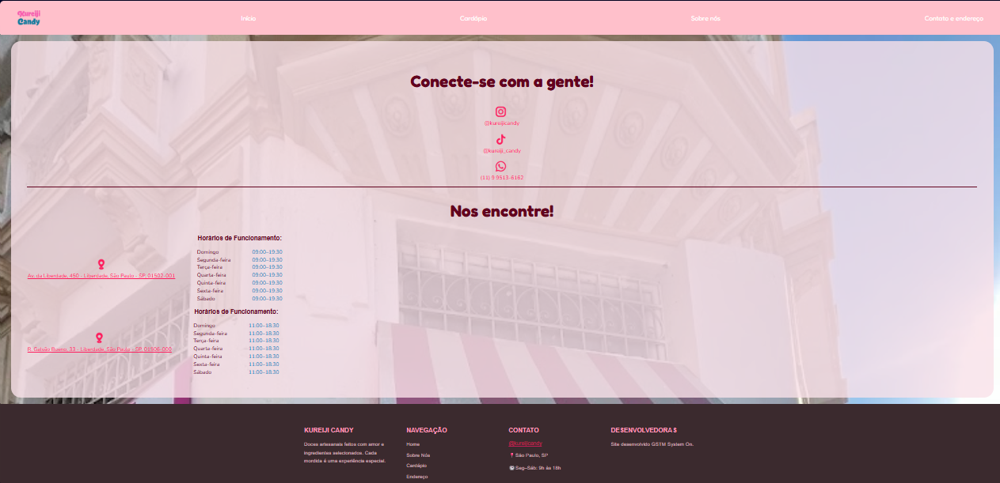

# Documento do Projeto — Kureiji Candy

## 1. Título do projeto

**Kureiji Candy — site de divulgação de uma doceria temática.**

## 2. Descrição do projeto

A Kureiji Candy é uma doceria que combina confeitaria, criatividade e referências à cultura japonesa e à cultura pop. O projeto consiste em um site para apresentar a marca, divulgar produtos, contar sua história e facilitar o contato dos clientes com a loja.

O site atende à necessidade de reunir essas informações em um só lugar. Sem essa centralização, quem deseja conhecer os doces, encontrar os endereços ou consultar os canais de contato precisa recorrer a diferentes redes sociais e serviços externos.

A solução oferece uma presença digital organizada e acessível, permitindo que clientes conheçam a loja e encontrem caminhos para consultar o cardápio, obter direções e acompanhar os perfis sociais. O conteúdo e a navegação refletem a identidade descontraída da marca.

## 3. Objetivo do projeto

### Objetivo geral

Desenvolver um site institucional para apresentar a Kureiji Candy e facilitar o acesso às informações sobre seus produtos, sua história e seus canais de atendimento.

### Objetivos específicos

- Apresentar a marca e seus produtos em destaque.
- Direcionar os visitantes ao cardápio da loja.
- Compartilhar a história e a proposta da doceria.
- Divulgar endereços, horários de funcionamento, telefone e redes sociais.
- Oferecer navegação simples entre as páginas do site.

## 4. Público-alvo

- Pessoas interessadas em doces, confeitaria e cafés.
- Fãs de animes, cultura japonesa e cultura pop.
- Moradores e visitantes da região da Liberdade, em São Paulo.
- Clientes que procuram o cardápio, os endereços ou os canais de contato da loja.

## 5. Principais funcionalidades

O escopo atual é de um site informativo. As funcionalidades implementadas ou representadas nas páginas são:

- Navegação entre Início, Cardápio, Sobre nós e Contato e endereço.
- Apresentação de produtos em destaque, com imagens, descrições e preços.
- Acesso ao cardápio por um link externo.
- Apresentação da história da marca e de seus fundadores.
- Exibição de telefone, perfis sociais, endereços e horários de funcionamento.
- Links externos para localização em mapas e avaliação da loja.

Não fazem parte da versão atual cadastro de usuários, login, carrinho, pagamento, pesquisa dinâmica, gerenciamento de produtos ou banco de dados. Essas funções poderiam ser consideradas em uma evolução futura, caso o projeto passe a oferecer pedidos ou administração de conteúdo pelo próprio site.

## 6. Tecnologias previstas

### Utilizadas na versão atual

- **HTML5:** estrutura e conteúdo das páginas.
- **CSS3:** estilos, cores, tipografia e organização visual.
- **Google Fonts:** fontes Fredoka e Nunito/Nunito Sans.
- **Imagens locais:** logotipo, fotos da loja, produtos e ícones.
- **Links externos:** cardápio, redes sociais, mapas e avaliação da loja.

A versão atual não apresenta framework JavaScript, linguagem de servidor ou banco de dados. Como o site é informativo e seus conteúdos estão escritos diretamente nas páginas, esses componentes não são necessários para o escopo atual.

### Possíveis tecnologias para expansão

Se futuramente houver necessidade de cadastro, pedidos ou atualização de conteúdo por uma área administrativa, será necessário definir tecnologias de back-end e armazenamento de dados. Essa expansão ainda não faz parte da proposta atual.

## 7. Esboço do projeto (layout)

Os esboços abaixo representam a organização prevista das telas, sem detalhar cores ou proporções exatas. A navegação principal deve permanecer disponível nas páginas.

### 7.1 Início

### 7.2 Cardápio

### 7.3 Sobre nós

### 7.4 Contato e endereço

### Navegação

A navegação começa pela página inicial e permite acessar as demais páginas pelo menu. A página inicial também direciona ao cardápio e à avaliação da loja. As páginas de contato e endereço oferecem acesso aos mapas e às redes sociais; o cardápio completo é consultado por meio de um serviço externo.
